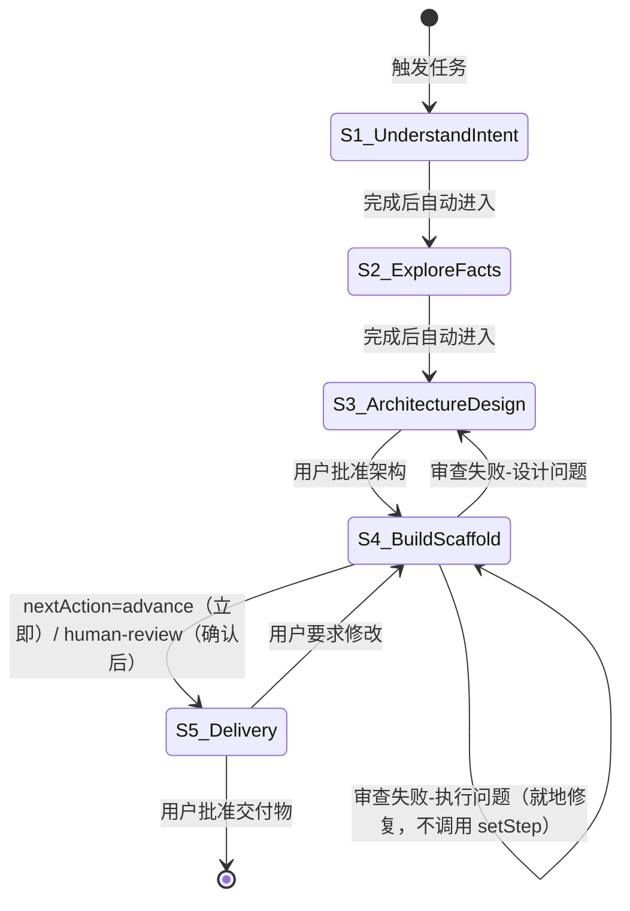

# 架构设计

**Template ID**: `arch-design`
**Category**: development
**Description**: 架构设计与项目冷启动流程（意图 → 事实 → 架构与分层 → 脚手架 → 交付）
**Command**: `/pm-arch-design`
**Version**: 0.4.0

---

## 适用场景

- 新项目或大型子系统的架构设计
- 项目冷启动：设计架构、分层，并搭建项目骨架
- 功能开发前定义模块边界、技术栈与约定

**不适用**：单个功能模块设计（使用 feat-design）；既有功能修改（使用 spec-driven-dev）。

---

## 输入要求

| 输入项 | 是否必填 | 说明 |
|--------|----------|------|
| 架构目标 | 是 | 要设计什么、为什么设计（新项目、子系统或重构） |
| 约束条件 | 否 | 已知的技术/业务约束 |

---

## 默认交付物

- 架构级 Spec 文档：系统架构总览、模块划分、部署模型与主要数据流向（S3 的交付物）；详细设计留给 feat-design
- 项目骨架：目录结构、基础配置、构建/测试配置（S4 的交付物）

> 用户可在启动任务时重新指定交付物；S1 中 LLM 必须与用户重新确认交付物与验收标准。

---

## 状态机

---

## 任务步骤

### S1: 理解意图

**Goal**: 准确理解架构设计意图并确认交付物。
**Output**: 清晰的架构意图 + 已确认的交付物与验收标准
**Output Checklist**: —
**Review Checklist**: —
**Output Review**: human
**Referenced Regulation**: —

1. 阅读用户的架构目标，提取核心意图——要设计什么？为什么？解决什么问题？
2. 识别已覆盖的信息与初步的缺口
3. 若意图含糊或存在歧义，通过渐进式提问与用户澄清：
   - 使用 `question` / `confirm` 阻塞式工具——每次只提一个问题
   - 等待用户回答后再提下一个问题
   - 若回答指向新的方向，先深入追问，再回到原本的路径
   - 循环提问直到用户确认“没有更多问题”
   - **绝不**用纯文本一次性批量提问
4. 展示交付物与验收标准（任务启动时用户已指定则用用户指定值，否则用默认值），并使用 `confirm` 工具与用户确认

**Upon completion**:
- 自动进入 S2

---

### S2: 探查事实

**Goal**: 为架构设计建立知识基线。
**Output**: 知识基线（既有代码结构、约束、约定）
**Output Checklist**: —
**Review Checklist**: —
**Output Review**: human
**Referenced Regulation**: —

1. 探查既有项目结构（若有）：模块、依赖、构建配置、约定
2. 按需调研外部参考（框架文档、最佳实践、开源示例）
3. 若事实含糊、有歧义或相互矛盾，通过渐进式提问与用户澄清：
   - 使用 `question` / `confirm` 阻塞式工具——每次只提一个问题
   - 等待用户回答后再提下一个问题
   - 若回答指向新的方向，先深入追问，再回到原本的路径
   - 循环提问直到用户确认“没有更多问题”
   - **绝不**用纯文本一次性批量提问
4. 记录关键发现与约束（技术栈、性能、安全、部署）
5. 汇总为知识基线

**引用工具**：explore / librarian Agent（按需并行）

**Upon completion**:
- 自动进入 S3

---

### S3: 架构与分层设计

**Goal**: 基于已确认的偏好产出架构级设计（Spec 文档）——架构总览、模块划分、部署模型与主要数据流向。
**Output**: 架构级 Spec 文档（架构总览、模块边界、部署模型、主要数据流向；在确认设计偏好后产出）。详细的接口/逻辑设计不在本步骤范围内。
**Output Checklist**:
- Spec 覆盖架构层面的关注点：架构总览、模块划分与职责、部署模型（或说明为何不适用）、主要数据流向
- 只写入已确认的信息；未决事项明确标注“待决策”（To be decided）并写明待决问题
- 未为填充模板章节而添加臆测的需求或详细设计
- 属于详细设计的章节（接口契约、内部逻辑、各模块数据结构）已省略或标注为“不适用”（Not Applicable）——留给 feat-design
- 所有图示使用 Mermaid（不使用 ASCII 图形）
- 每个架构决策都可追溯到 S1/S2 的结论
- Spec 文档遵循 Spec 模板结构（spec-template.md），仅保留适用的章节
**Review Checklist**:
- 架构合理性：分层与模块边界有充分依据
- 模块独立性：不存在跨模块的内部访问
- 技术栈符合项目约束与目标
- 设计一致性：模块之间、数据流之间无矛盾
- 范围纪律：仅限架构层面——不掺入详细设计，不为填充模板章节而臆造需求
**Output Review**: self-check + review-agent + human
**Referenced Regulation**: /docs/regulation/spec-template.md, /docs/regulation/constitution.md

1. 识别关键架构决策点（技术栈、模块边界、分层方式、部署模型、约定）
2. 对每个存在多种可行方案的关键决策点，使用 `question` 工具给出 2-3 个设计备选方案，让用户选择最贴近其设计意图的一个：
   - 每次只讨论一个设计点
   - 每个备选方案简要说明其取舍
   - 循环直到所有关键设计点都已确定
   - **绝不**用纯文本一次性批量提问
3. 基于选定的偏好进行架构层面的设计：
   - 系统上下文与架构总览
   - 模块划分、职责与依赖方向
   - 部署模型（运行单元、进程、外部依赖；若项目无部署模型则说明为何不适用）
   - 模块之间的主要数据流向
   - 不要下探到详细设计（接口契约、内部逻辑、各模块数据结构）——那属于 feat-design
4. 按 Spec 模板结构撰写架构 Spec：
   - 只填写已确认的信息；未决事项标注为“待决策”（To be decided）并写明待决问题
   - 属于详细设计的章节（如详细的接口设计、内部逻辑、功能级测试用例）省略或标注为“不适用”（Not Applicable）
   - 不为填充模板章节而臆造需求或详细设计
5. 展示架构设计，并使用 `confirm` 工具等待用户批准

**Upon completion**:
- 用户批准架构 → 自动进入 S4

---

### S4: 搭建项目骨架

**Goal**: 按已批准的架构搭建项目骨架。
**Output**: 项目骨架（目录结构、基础配置、构建/测试配置，在确认设计偏好后产出）
**Output Checklist**:
- 目录结构与已批准的架构与分层一致
- 基础配置（构建、测试、lint）已就绪且可运行
- LSP 诊断零错误
- 构建通过
**Review Checklist**:
- 骨架与已批准的架构设计一致（结构、分层、配置）
- 未在已批准架构之外做额外改动
**Output Review**: self-check + review-agent + human
**Referenced Regulation**: /docs/regulation/constitution.md, coding_style.md

1. 按已批准的架构创建目录结构
2. 搭建基础配置（构建 / 测试 / lint）与最小可运行的骨架
3. 运行验证（LSP 诊断 / 构建 / 测试）
4. 展示骨架摘要，并使用 `confirm` 工具等待验收（未通过 → 按 FSM 回退边重做）

**Upon completion**:
- 遵循 `pm_task_verify` 的 `nextAction`：`auto-fix-and-review` → 修复 blocker/major 并重新验证；`rollback-design` → 回到 S3；`ask-user` → 按用户的决定执行；`human-review` + 用户确认 → S5；`advance` → S5。
- 执行类阻塞就地修复并重新审查；执行自循环不要调用 `pm_task_set_step`。

---

### S5: 交付

**Goal**: 交付物验收与任务收尾。
**Output**: 验收结论 + 任务已关闭
**Output Checklist**: —
**Review Checklist**: —
**Output Review**: human
**Referenced Regulation**: —

1. 汇总所有任务产出，并展示交付物与验收标准的对照
2. 使用 `confirm` 工具等待用户验收（未通过 → 按 FSM 边回到 S4）
3. 验收通过后，使用 `question` 工具询问用户：“是否执行 `git commit`？”
   - 用户选择“是”：运行 `git add -A && git commit`，以架构总结作为提交信息
   - 用户选择“否”：跳过提交
   - ⚠️ 用户的选择不影响任务完成
4. 调用 `pm_task_close()` 结束任务并触发分析

**Upon completion**:
- 用户批准交付物 → 任务结束（终态）
- 用户要求修改 → 回到 S4
