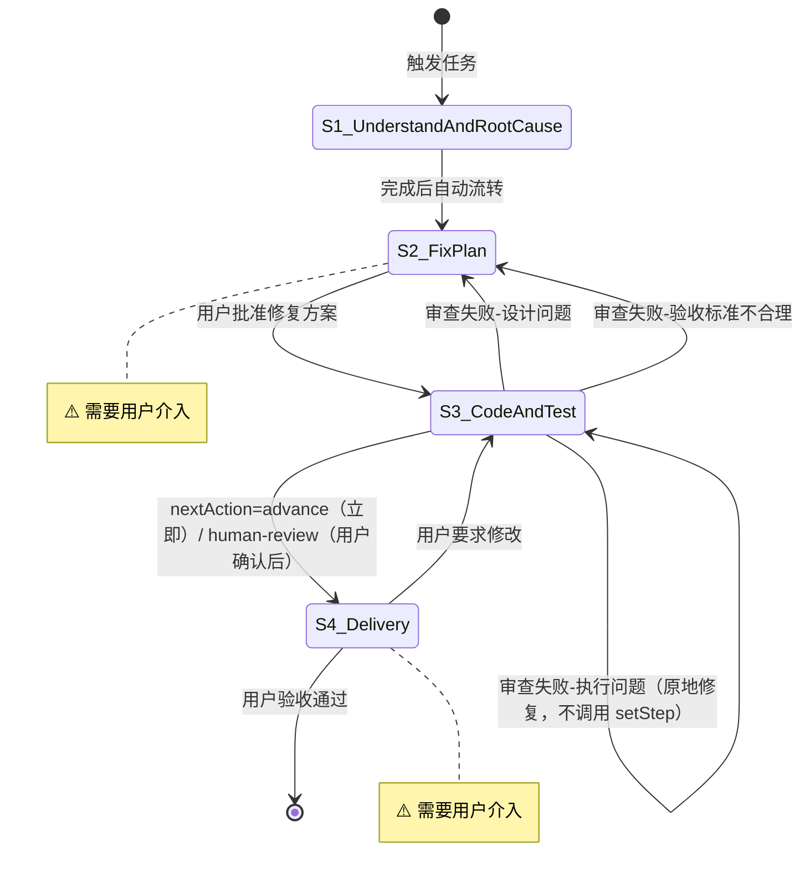

# Bug 修复

**Template ID**: `bug-fix`
**Category**: maintenance
**Description**: 标准化的 Bug 修复工作流（理解与根因分析 → 修复方案 → 代码与测试 → 交付）
**Command**: `/pm-bug-fix`
**Version**: 0.3.0

---

## 适用场景

- 生产环境或开发环境中的 Bug 修复
- 需要根因分析的非简单修复
- 需要回归测试的修复

---

## 输入要求

| 输入项 | 是否必需 | 说明 |
|------------|----------|-------------|
| Bug 描述 | 是 | 现象、复现步骤、影响范围 |
| 相关代码/日志 | 否 | 帮助定位问题的信息 |

---

## 默认交付清单

- 根因分析结论（在 S1 产出）
- 修复代码 + 回归测试（在 S3 产出）
- 交付报告（在 S4 产出）

> 用户可在启动任务时重新指定交付物；在 S1 中 LLM 必须与用户重新确认交付物与验收标准。

---

## 状态机

---

## 任务步骤

### S1: 理解 Bug 与根因

**Goal**: 准确理解 Bug 并定位根因。
**Output**: Bug 理解 + 根因分析结论
**Output Checklist**: —
**Review Checklist**: —
**Output Review**: human
**Referenced Regulation**: —

1. 阅读 Bug 描述、日志与截图，确认复现步骤，评估影响范围（功能、数据、安全）
2. 若描述不清或存在歧义，通过渐进式提问与用户澄清：
   - 使用 `question` / `confirm` 阻塞式工具，一次只问一个问题
   - 等待用户回应后再问下一个问题
   - 若回答引向新方向，先深入追问，再回到原路径
   - 循环直至用户确认“没有更多问题”
   - **绝不**在纯文本中批量抛出多个问题
3. 阅读相关源码并追踪调用链以定位根因（引用具体文件与行号）
4. 若观察到的事实含糊、有歧义或自相矛盾，通过渐进式提问与用户澄清：
   - 使用 `question` / `confirm` 阻塞式工具，一次只问一个问题
   - 等待用户回应后再问下一个问题
   - 若回答引向新方向，先深入追问，再回到原路径
   - 循环直至用户确认“没有更多问题”
   - **绝不**在纯文本中批量抛出多个问题
5. 分析测试覆盖：现有测试是否覆盖该路径？为何未捕获（断言过弱 / mock 过于理想 / 测试被跳过）？缺少哪个测试场景？
6. 呈现根因分析，并使用 `confirm` 工具等待用户确认接受

**Upon completion**:
- 用户接受根因 → 自动进入 S2

---

### S2: 设计修复方案

**Goal**: 产出经批准、偏好与测试用例均已确认的修复方案。
**Output**: 修复方案（在设计偏好与测试用例确认后产出）
**Output Checklist**:
- 修复方案覆盖已确认的根因
- 已识别回归测试用例，且每条用例均标注类型（单元测试 / 集成测试 / E2E 测试 / 人工测试）
- 测试用例清晰且可验证
**Review Checklist**: —
**Output Review**: self-check + human
**Referenced Regulation**: —

1. 识别关键的修复设计决策点（修复方式、是否增加兼容层、测试范围）
2. 对每个存在多个可行方案的关键设计点，使用 `question` 工具呈现 2-3 种设计方案，让用户选择最贴近其设计意图的一种：
   - 一次只讨论一个设计点
   - 每个备选方案简要说明其权衡
   - 循环直至所有关键设计点均已确定
   - **绝不**在纯文本中批量抛出多个问题
3. 与用户确认测试用例：呈现按类型分类的回归测试用例（单元测试 / 集成测试 / E2E 测试 / 人工测试；人工测试须写明具体操作步骤与预期结果）
4. 以最简可行方案设计修复计划：要做的修改、要补充的测试用例（按类型分类）、风险评估
5. 呈现修复方案（根因、修复方式、备选方案、风险），并使用 `confirm` 工具等待批准

**Upon completion**:
- 用户批准修复方案 → 自动进入 S3

---

### S3: 编码与测试

**Goal**: 实现已批准的修复并通过全部验证。
**Output**: 代码变更与测试结果
**Output Checklist**:
- LSP 诊断零错误
- 构建通过
- 全部测试通过，包括覆盖复现场景的回归测试
- 无类型逃逸（any / @ts-ignore）
**Review Checklist**:
- 修复针对已确认的根因（非打补丁式修补）
- 代码优雅整洁——遵循代码质量优先，减少重复
- 回归测试充分覆盖边界情况与相关功能
- 除修复范围外无无关变更
**Output Review**: self-check + review-agent + human
**Referenced Regulation**: /docs/regulation/constitution.md, coding_style.md

1. 以代码质量优先编写修复——尽可能优雅地完成修改：整洁、可读、减少重复
2. 编写回归测试：覆盖复现场景、边界情况与相关功能（防止副作用）；不要删除失败的测试
3. 运行验证（LSP 诊断 / 构建 / 测试），确认原始 Bug 场景不再复现
4. 声明输出完成（调用输出验证入口 `pm_task_verify`）；由审查 Agent 验证步骤输出，再由用户确认

**Upon completion**:
- 按 `pm_task_verify` 返回的 `nextAction` 执行：`auto-fix-and-review` → 修复 blocker/major 后复审；`rollback-design` → 返回 S2；`ask-user` → 按用户裁决继续；`human-review` + 用户确认 → S4；`advance` → S4。
- 执行问题在当前步骤原地修复并复审，不调用 `pm_task_set_step` 走执行问题自环。

---

### S4: 交付

**Goal**: 交付物验收与任务关闭。
**Output**: 验收结论 + 任务已关闭
**Output Checklist**:
- 测试用例表已记录每条回归测试用例对应的测试文件与测试方法
- 人工测试用例已记录其执行结果
**Review Checklist**: —
**Output Review**: human
**Referenced Regulation**: —

1. 呈现修复报告（根因、变更、测试结果）以及交付物与验收标准的对照
2. 在测试用例表（Spec 文档或修复报告）中补全每条回归测试用例对应的测试文件与测试方法（人工测试用例记录其验证结果）
3. 使用 `confirm` 工具等待用户验收（未通过 → 按 FSM 边返回 S3）
4. 运行最终验证（LSP 诊断 / 构建 / 测试）
5. 使用 `question` 工具询问用户：“是否执行 `git commit`？”
   - 若用户选择“是”：执行 `git add -A && git commit`，使用修复摘要作为提交信息
   - 若用户选择“否”：跳过提交
   - ⚠️ 用户的选择不影响任务完成
6. 调用 `pm_task_close()` 结束任务并触发分析

**Upon completion**:
- 用户验收通过 → 任务结束（终态）
- 用户要求修改 → 返回 S3
