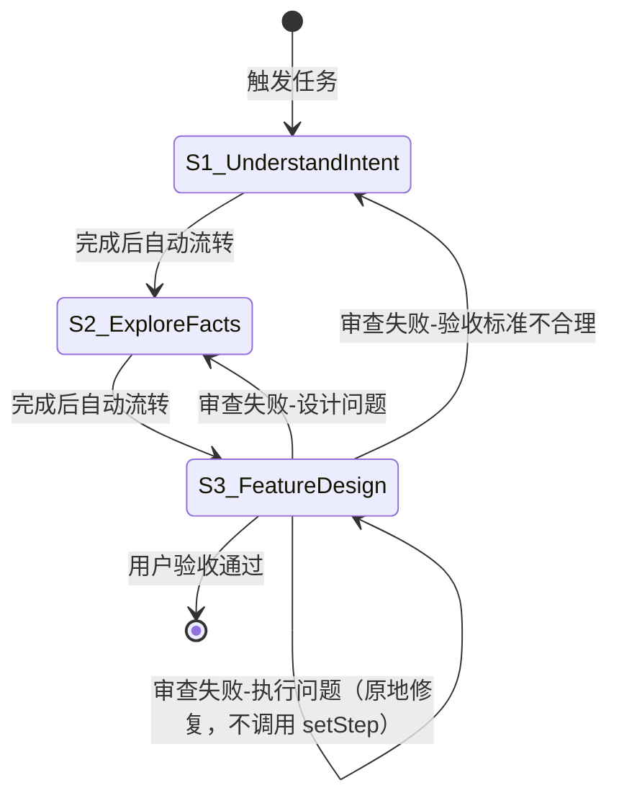

# 功能设计

**Template ID**: `feat-design`
**Category**: design
**Description**: 单功能模块设计工作流（意图 → 事实 → 详细功能设计）
**Command**: `/pm-feat-design`
**Version**: 0.3.0

---

## 适用场景

- 在实现前设计单个功能模块（数据模型、接口、行为）
- 将模糊的功能需求转化为结构化的设计文档
- 后续将通过 spec-driven-dev 实现的功能级设计

**不适用**：架构设计 / 项目冷启动（使用 arch-design）；代码实现（使用 spec-driven-dev）。

---

## 输入要求

| 输入项 | 是否必需 | 说明 |
|------------|----------|-------------|
| 功能描述 | 是 | 功能构想、问题陈述、目标概述 |
| 约束条件 | 否 | 已知的技术/业务约束 |

---

## 默认交付清单

- 功能设计文档（数据模型、接口、行为、边界情况）
- 产出 Spec 时的设计文档格式参考：`regulation/spec-template.md`

> 用户可在启动任务时重新指定交付物；在 S1 中 LLM 必须与用户重新确认交付物与验收标准。

---

## 状态机

> **说明**：feat-design 没有独立的交付步骤——交付物验收、git 提交询问与任务关闭均由 S3 的人工审查环节处理。

---

## 任务步骤

### S1: 理解意图

**Goal**: 准确理解功能设计意图，并确认交付物。
**Output**: 明确的功能意图 + 已确认的交付物与验收标准
**Output Checklist**: —
**Review Checklist**: —
**Output Review**: human
**Referenced Regulation**: —

1. 逐段阅读用户的功能描述
2. 提取核心意图——要设计什么功能？它解决什么问题？
3. 识别已覆盖的信息与初步发现的缺口
4. 若意图含糊或有歧义，通过渐进式提问与用户澄清：
   - 使用 `question` / `confirm` 阻塞式工具，一次只问一个问题
   - 等待用户回应后再问下一个问题
   - 若回答引向新方向，先深入追问，再回到原路径
   - 循环直至用户确认“没有更多问题”
   - **绝不**在纯文本中批量抛出多个问题
5. 呈现交付物与验收标准（任务启动时用户若已指定则采用其指定值，否则使用默认值），并使用 `confirm` 工具与用户确认

**Upon completion**:
- 自动进入 S2

---

### S2: 探索事实

**Goal**: 为功能设计建立知识基线。
**Output**: 知识基线（相关的既有代码、约定、约束）
**Output Checklist**: —
**Review Checklist**: —
**Output Review**: human
**Referenced Regulation**: —

1. 探索项目内相关代码与文档（既有模块、数据模型、约定）
2. 按需调研外部参考（框架文档、最佳实践、开源示例）
3. 若事实含糊、有歧义或自相矛盾，通过渐进式提问与用户澄清：
   - 使用 `question` / `confirm` 阻塞式工具，一次只问一个问题
   - 等待用户回应后再问下一个问题
   - 若回答引向新方向，先深入追问，再回到原路径
   - 循环直至用户确认“没有更多问题”
   - **绝不**在纯文本中批量抛出多个问题
4. 记录关键发现与约束条件
5. 汇总为知识基线

**Referenced tools**: explore / librarian Agent（按需并行）

**Upon completion**:
- 自动进入 S3

---

### S3: 详细功能设计

**Goal**: 基于已确认的偏好产出详细的功能设计。
**Output**: 功能设计交付物（数据模型、接口、行为、边界情况；在设计偏好确认后产出）
**Output Checklist**:
- 设计覆盖全部已确认需求与已知边界情况（逐条对应）
- 验收标准清晰且可验证
- 无超出已确认意图的范围外设计
**Review Checklist**:
- 接口明确（输入、输出、类型、边界条件）
- 设计与项目既有模式及约束保持一致
- 设计一致性：数据模型、接口与行为之间无矛盾
- 边界情况覆盖充分
**Output Review**: self-check + review-agent + human
**Referenced Regulation**: /docs/regulation/spec-template.md

1. 识别关键的功能设计决策点（范围、接口风格、数据模型取向、边界情况处理策略）
2. 对每个存在多个可行方案的关键设计点，使用 `question` 工具呈现 2-3 种设计方案，让用户选择最贴近其设计意图的一种：
   - 一次只讨论一个设计点
   - 每个备选方案简要说明其权衡
   - 循环直至所有关键设计点均已确定
   - **绝不**在纯文本中批量抛出多个问题
3. 基于所选偏好设计功能：数据模型、接口、行为流程、边界情况
4. 撰写功能设计文档（适用时采用 Spec 格式）
5. 呈现设计摘要，并使用 `confirm` 工具等待用户验收（未通过 → 按 FSM 回退边重做）
6. 验收通过后，使用 `question` 工具询问用户：“是否执行 `git commit`？”
   - 若用户选择“是”：执行 `git add -A && git commit`，使用设计摘要作为提交信息
   - 若用户选择“否”：跳过提交
   - ⚠️ 用户的选择不影响任务完成
7. 调用 `pm_task_close()` 结束任务并触发分析

**Upon completion**:
- 按 `pm_task_verify` 返回的 `nextAction` 执行：`auto-fix-and-review` → 修复 blocker/major 后复审；`rollback-design` → 返回 S2（验收标准：S1）；`ask-user` → 按用户裁决继续；`human-review` + 用户验收通过 → 任务结束；`advance` → 任务结束。
- 执行问题在当前步骤原地修复并复审，不调用 `pm_task_set_step` 走执行问题自环。
