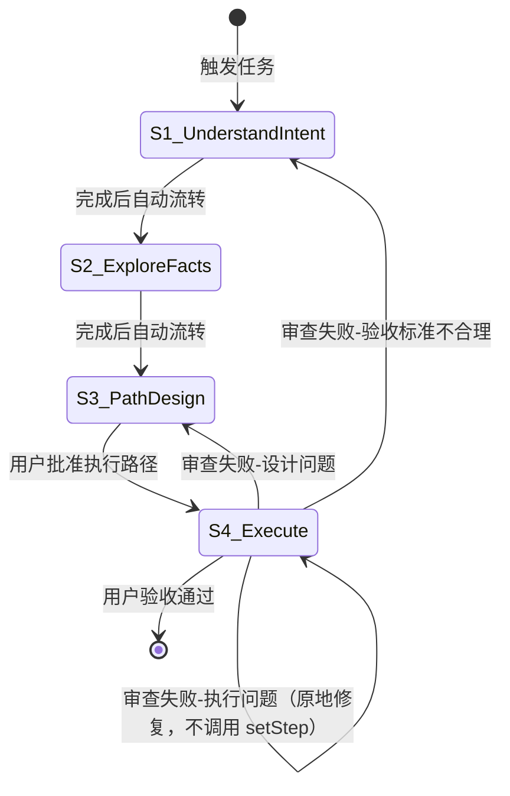

# 调研任务

**Template ID**: `research`
**Category**: research
**Description**: 用于梳理需求、设计文档与研究分析的调研工作流
**Command**: `/pm-research`
**Version**: 0.3.0

---

## 适用场景

- 梳理需求、整理维护文档
- 调研分析、研究开放性问题
- 设计撰写 Spec 文档、技术方案

**不适用**：代码实现、Bug 修复。

---

## 输入要求

| 输入项 | 是否必需 | 说明 |
|------------|----------|-------------|
| 需求描述 / 草案 / 初始想法 | 是 | 描述要解决的问题或要达成的目标 |

输入不满足要求时，引导用户补充后再继续。

---

## 默认交付清单

- 调研报告 / Spec 文档 / 技术方案
- 若涉及规划阶段，将计划文档输出到 `docs/plan/plan-*.md`

> 用户可在启动任务时重新指定交付物；在 S1 中 LLM 必须与用户重新确认交付物与验收标准。

---

## 状态机

> **说明**：research 没有独立的交付步骤——交付物验收、git 提交询问与任务关闭均由 S4 的人工审查环节处理。

---

## 任务步骤

### S1: 理解意图

**Goal**: 准确理解用户输入的核心意图，并确认交付物。
**Output**: 明确的任务意图 + 已确认的交付物与验收标准
**Output Checklist**: —
**Review Checklist**: —
**Output Review**: human
**Referenced Regulation**: —

1. 逐段阅读用户提供的描述
2. 提取核心意图——要解决什么问题？要达成什么目标？
3. 识别已覆盖的信息与初步发现的缺口
4. 若意图含糊或有歧义，通过渐进式提问与用户澄清：
   - 使用 `question` / `confirm` 阻塞式工具，一次只问一个问题
   - 等待用户回应后再问下一个问题
   - 若回答引向新方向，先深入追问，再回到原路径
   - 循环直至用户确认“没有更多问题”
   - **绝不**在纯文本中批量抛出多个问题
5. 呈现交付物与验收标准（任务启动时用户若已指定则采用其指定值，否则使用默认值），并使用 `confirm` 工具与用户确认

**Upon completion**:
- 自动进入 S2

---

### S2: 探索事实

**Goal**: 搜索项目内外部相关信息，建立知识基线。
**Output**: 知识基线（已知事实清单）
**Output Checklist**: —
**Review Checklist**: —
**Output Review**: human
**Referenced Regulation**: —

1. 搜索项目内已有的相关文档与代码
2. 搜索外部参考资料（文档、最佳实践、开源实现）
3. 若事实含糊、有歧义或自相矛盾，通过渐进式提问与用户澄清：
   - 使用 `question` / `confirm` 阻塞式工具，一次只问一个问题
   - 等待用户回应后再问下一个问题
   - 若回答引向新方向，先深入追问，再回到原路径
   - 循环直至用户确认“没有更多问题”
   - **绝不**在纯文本中批量抛出多个问题
4. 记录关键发现与约束条件
5. 汇总发现，建立知识基线

**Referenced tools**: explore / librarian Agent（按需并行）

**Upon completion**:
- 自动进入 S3

---

### S3: 设计执行路径

**Goal**: 基于澄清后的需求与已确认的偏好设计执行路径。
**Output**: 执行路径方案（在设计偏好确认后产出）
**Output Checklist**: —
**Review Checklist**: —
**Output Review**: human
**Referenced Regulation**: —

1. 识别执行路径的关键设计决策点（方案取向、范围、交付物形态、子任务拆分策略）
2. 对每个存在多个可行方案的关键设计点，使用 `question` 工具呈现 2-3 种设计方案，让用户选择最贴近其设计意图的一种：
   - 一次只讨论一个设计点
   - 每个备选方案简要说明其权衡
   - 循环直至所有关键设计点均已确定
   - **绝不**在纯文本中批量抛出多个问题
3. 基于所选偏好设计执行路径：勾勒完整计划——模块、步骤、数据流、边界情况处理
4. 将任务拆解为可独立执行与验证的子任务，标注依赖关系与并行机会
5. 呈现路径设计，并使用 `confirm` 工具等待批准

**Upon completion**:
- 用户批准执行路径 → 自动进入 S4

---

### S4: 执行

**Goal**: 执行已批准的路径，产出最终交付物。
**Output**: 指定交付物（调研报告 / Spec 文档 / 技术方案）
**Output Checklist**:
- 交付物回答了调研问题 / 覆盖全部已确认需求（逐条对应）
- 结论由已收集的事实支撑，并注明来源
- 已处理 S2/S3 中识别的边界情况与约束
- 无超出已批准路径的范围外变更
**Review Checklist**: —
**Output Review**: self-check + human
**Referenced Regulation**: —

1. 按计划顺序执行子任务，产出最终交付物
2. 标记 `[P]` 的子任务可并行处理；每完成一个子任务后更新进度
3. 汇总所有产出，呈现最终交付物的摘要
4. 使用 `confirm` 工具等待用户验收（未通过 → 按 FSM 回退边重做）
5. 验收通过后，使用 `question` 工具询问用户：“是否执行 `git commit`？”
   - 若用户选择“是”：执行 `git add -A && git commit`，使用调研摘要作为提交信息
   - 若用户选择“否”：跳过提交
   - ⚠️ 用户的选择不影响任务完成
6. 调用 `pm_task_close()` 结束任务并触发分析

**Upon completion**:
- 按 `pm_task_verify` 返回的 `nextAction` 执行：`auto-fix-and-review` → 修复 blocker/major 后复审；`rollback-design` → 返回 S3（验收标准：S1）；`ask-user` → 按用户裁决继续；`human-review` + 用户验收通过 → 任务结束；`advance` → 任务结束。
- 执行问题在当前步骤原地修复并复审，不调用 `pm_task_set_step` 走执行问题自环。
