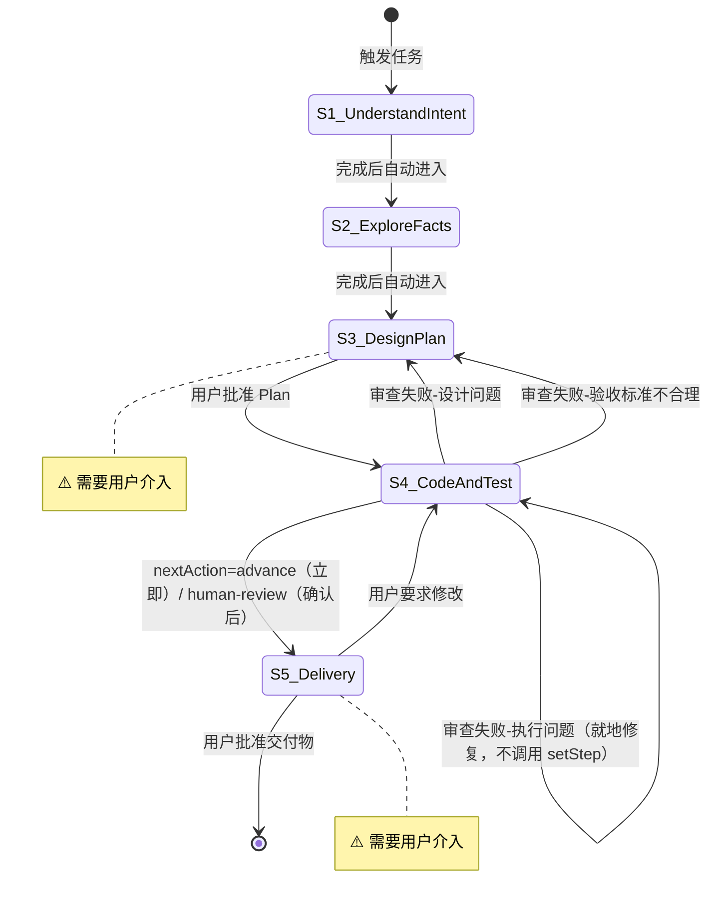

# 快速周转任务

**Template ID**: `side-job`
**Category**: side-job
**Description**: 快速周转类任务流程——LLM 必须在执行前与用户确认 Plan
**Command**: `/pm-side-job`
**Version**: 0.3.0

---

## 适用场景

- 意图明确、无需深入调研的独立小任务
- 一次性修改、配置调整、小规模重构、脚本编写等
- 用户希望 LLM 先想清楚方案并取得确认再动手

**不适用**：复杂架构设计、需要根因分析的 Bug 修复、大规模重构。

---

## 输入要求

| 输入项 | 是否必填 | 说明 |
|--------|----------|------|
| 任务描述 | 是 | 要做什么，以及期望的结果 |

若输入不满足要求，先引导用户补充后再继续。

---

## 默认交付物

- 完成用户描述的任务
- 若涉及代码改动，通过 LSP 诊断、构建与测试验证

> 用户可在启动任务时重新指定交付物；S1 中 LLM 必须与用户重新确认交付物与验收标准。

---

## 状态机

---

## 任务步骤

### S1: 理解意图

**Goal**: 准确理解用户想做什么，并确认交付物。
**Output**: 清晰的意图 + 已确认的交付物与验收标准
**Output Checklist**: —
**Review Checklist**: —
**Output Review**: human
**Referenced Regulation**: —

1. 阅读用户的描述，提取核心任务与约束
2. 按需阅读相关源码与文档（直接使用 read 工具）
3. 在项目内检索相关文件以理解既有模式（使用 explore Agent 并行检索）
4. 若描述不清或存在歧义，通过渐进式提问与用户澄清：
   - 使用 `question` / `confirm` 阻塞式工具——每次只提一个问题
   - 等待用户回答后再提下一个问题
   - 若回答指向新的方向，先深入追问，再回到原本的路径
   - 循环提问直到用户确认“没有更多问题”
   - **绝不**用纯文本一次性批量提问
5. 展示交付物与验收标准（任务启动时用户已指定则用用户指定值，否则用默认值），并使用 `confirm` 工具与用户确认

**注意**：本步骤中**不要**编辑、创建或删除任何文件。

**Upon completion**:
- 自动进入 S2

---

### S2: 探查事实

**Goal**: 建立本任务的知识基线。
**Output**: 知识基线（已知事实与约束）
**Output Checklist**: —
**Review Checklist**: —
**Output Review**: human
**Referenced Regulation**: —

1. 探查项目内的相关代码与文档，理解既有模式
2. 若事实含糊、有歧义或相互矛盾，通过渐进式提问与用户澄清：
   - 使用 `question` / `confirm` 阻塞式工具——每次只提一个问题
   - 等待用户回答后再提下一个问题
   - 若回答指向新的方向，先深入追问，再回到原本的路径
   - 循环提问直到用户确认“没有更多问题”
   - **绝不**用纯文本一次性批量提问
3. 考虑 2-3 种可行方案，分别评估其改动范围、风险与影响
4. 将关键发现与约束整理为知识基线

**Upon completion**:
- 自动进入 S3

---

### S3: 设计 Plan

**Goal**: 在偏好与测试用例确认后产出已获批准的执行 Plan。
**Output**: 设计 Plan（在确认设计偏好与测试用例后产出）
**Output Checklist**:
- Plan 覆盖任务描述的全部内容
- 测试用例清晰且可验证；涉及代码改动时，每个测试用例都声明其类型（Unit / Integration / E2E / Manual）
- 未超出任务范围做额外改动
**Review Checklist**: —
**Output Review**: self-check + human
**Referenced Regulation**: —

1. 识别任务的关键设计决策点（技术方案 / 实现偏好、范围边界）
2. 对每个存在多种可行方案的关键设计点，使用 `question` 工具给出 2-3 个设计备选方案，让用户选择最贴近其设计意图的一个：
   - 每次只讨论一个设计点
   - 每个备选方案简要说明其取舍
   - 循环直到所有关键设计点都已确定
   - **绝不**用纯文本一次性批量提问
3. 与用户确认测试用例（当任务涉及代码改动时）：按类型列出测试用例（Unit / Integration / E2E / Manual；手工用例须写明具体步骤与预期结果）
4. 设计执行 Plan，至少包含：
   - **任务理解**：一句话说明要做什么
   - **执行步骤**：具体要改哪些文件、做什么改动（顺序与依赖关系）
   - **测试用例**：按 Unit / Integration / E2E / Manual 分类的测试用例（当任务涉及代码改动时）
   - **影响范围**：可能受影响的模块或功能
   - **风险点**：需要留意的部分（如有）
   - 遵循 S2 中识别出的项目既有模式
5. ⚠️ 使用 `confirm` / `question` 工具等待用户明确确认：
   - 必须收到“已确认 / 同意 / 批准 / 没问题 / OK / 开始吧 / LGTM”等**明确肯定**的指令后才能继续
   - 含糊或弱肯定的表述（“看着能做”、“试试看”、“嗯”、“应该可以”）视为**未确认**——必须继续追问用户的明确态度
6. 在收到明确确认前，**严禁**进行任何代码修改、文件编辑或 todo 创建

**Upon completion**:
- 用户明确确认 → 自动进入 S4

---

### S4: 编码与测试

**Goal**: 执行已批准的 Plan，并通过全部验证。
**Output**: 代码改动与测试结果
**Output Checklist**:
- LSP 诊断零错误
- 构建通过
- 测试通过（若适用）
- 无类型逃逸（any / @ts-ignore）
- 变更范围与 Plan 一致
**Review Checklist**:
- 代码质量：优雅、可读、无重复
- 实现遵循 S3 中确认的 Plan
- 无多余重构或隐藏改动
**Output Review**: self-check + review-agent + human
**Referenced Regulation**: /docs/regulation/constitution.md, coding_style.md

1. 创建 todo 清单（若任务包含多个子步骤）
2. 严格遵循 S3 中确认的 Plan：
   - 只修改 Plan 中列出的文件
   - 不引入 Plan 之外的改动
   - 遵循项目宪法的“代码质量优先”原则
3. 完成每个子步骤后更新 todo 状态
4. 运行验证（LSP 诊断 / 构建 / 类型检查 / 测试）
5. 声明输出完成（调用输出验证入口 `pm_task_verify`）；由审查 Agent 验证步骤输出，随后由用户确认

**Upon completion**:
- 遵循 `pm_task_verify` 的 `nextAction`：`auto-fix-and-review` → 修复 blocker/major 并重新验证；`rollback-design` → 回到 S3；`ask-user` → 按用户的决定执行；`human-review` + 用户确认 → S5；`advance` → S5。
- 执行类阻塞就地修复并重新审查；执行自循环不要调用 `pm_task_set_step`。

---

### S5: 交付

**Goal**: 交付物验收与任务收尾。
**Output**: 验收结论 + 任务已关闭
**Output Checklist**:
- 任务中新增或变更的测试用例记录了实现每个用例的测试文件与测试方法
- 手工测试用例记录了其验证结果
**Review Checklist**: —
**Output Review**: human
**Referenced Regulation**: —

1. 展示执行总结：
   - 修改了哪些文件
   - 做了哪些改动（diff 摘要）
   - 测试用例：新增或更新了哪些测试文件 / 测试方法，以及验证结果（含手工测试用例，如有）
   - 验证结果（构建 / 类型检查 / LSP 诊断是否通过）
2. 展示交付物与验收标准的对照；使用 `confirm` / `question` 工具等待用户确认验收（未通过 → 按 FSM 边回到 S4）
3. 验收通过后，使用 `question` 工具询问用户：“是否执行 `git commit`？”
   - 用户选择“是”：运行 `git add -A && git commit`，以任务总结作为提交信息
   - 用户选择“否”：跳过提交
   - ⚠️ 用户的选择不影响任务完成
4. 调用 `pm_task_close()` 结束任务并触发分析

**Upon completion**:
- 用户批准交付物 → 任务结束（终态）
- 用户要求修改 → 回到 S4
