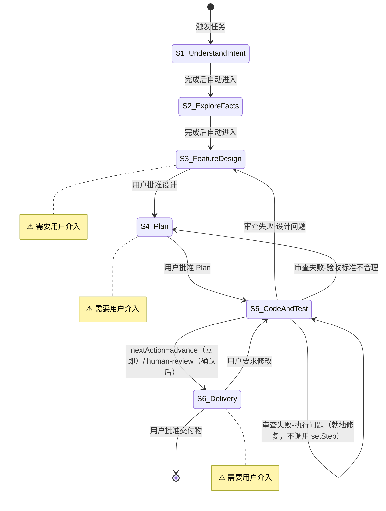

# Spec 驱动开发

**Template ID**: `spec-driven-dev`
**Category**: development
**Description**: Spec 驱动的标准化开发流程（理解/设计/Plan/编码/测试/交付，共 6 个 Step）
**Command**: `/pm-spec-driven-dev`
**Version**: 0.3.0

---

## 适用场景

- 中大型新功能开发
- 涉及多模块交互的任务
- 需要澄清需求的复杂任务
- 已有 Spec 文档的功能修改

---

## 输入要求

| 输入项 | 是否必填 | 说明 |
|--------|----------|------|
| Spec 文档 | 否 | 已有的规格说明文档（存在时读取；在 S3 中编写/更新） |
| 变更请求 | 是 | 需要改什么、为什么改 |

---

## 默认交付物

- 更新后的 Spec 文档（功能设计，在 S3 产出）
- 代码实现 + 测试代码（在 S5 产出）
- 交付报告（在 S6 产出）

> 用户可在启动任务时重新指定交付物；S1 中 LLM 必须与用户重新确认交付物与验收标准。

---

## 状态机

---

## 任务步骤

### S1: 理解意图

**Goal**: 准确理解变更意图、当前代码状态与交付要求。
**Output**: 清晰的开发意图 + 已确认的交付物与验收标准
**Output Checklist**: —
**Review Checklist**: —
**Output Review**: human
**Referenced Regulation**: —

1. 阅读用户提交的变更请求
2. 提取核心意图——需要改什么？为什么要改？
3. 从 `docs/spec/` 目录定位并阅读对应的 Spec 文档（**不要**跳过此步），随后阅读相关源码
4. 标记已覆盖、含糊与缺失的信息
5. 若意图含糊或存在歧义，通过渐进式提问与用户澄清：
   - 使用 `question` / `confirm` 阻塞式工具——每次只提一个问题
   - 等待用户回答后再提下一个问题
   - 若回答指向新的方向，先深入追问，再回到原本的路径
   - 循环提问直到用户确认“没有更多问题”
   - **绝不**用纯文本一次性批量提问
6. 展示交付物与验收标准（任务启动时用户已指定则用用户指定值，否则用默认值），并使用 `confirm` 工具与用户确认

**Upon completion**:
- 自动进入 S2

---

### S2: 探查事实

**Goal**: 建立需求、差距与约束的知识基线。
**Output**: 知识基线（事实、差距与约束）
**Output Checklist**: —
**Review Checklist**: —
**Output Review**: human
**Referenced Regulation**: —

1. 将 Spec 与变更请求交叉比对，标记缺失项、含糊项与矛盾项
2. 按影响程度对差距排序
3. 通过渐进式提问与用户澄清含糊之处：
   - 使用 `question` / `confirm` 阻塞式工具——每次只提一个问题
   - 等待用户回答后再提下一个问题
   - 若回答指向新的方向，先深入追问，再回到原本的路径
   - 循环提问直到用户确认“没有更多问题”
   - **绝不**用纯文本一次性批量提问
4. 基于澄清后的回答重新分析差距清单；若出现新问题则继续访谈，否则收敛为知识基线

**Upon completion**:
- 自动进入 S3

---

### S3: 功能详细设计

**Goal**: 基于已确认的偏好产出功能设计（并更新 Spec 文档）。
**Output**: 功能设计（在确认设计偏好后产出；Spec 文档已更新）
**Output Checklist**:
- 设计覆盖全部已澄清的需求（每条需求都映射到设计章节）
- 定稿设计前已核实第三方依赖的可用能力
- Spec 文档已更新以反映确认后的设计（每一处变更都可追溯到访谈结论）
**Review Checklist**:
- 设计符合项目既有模式与宪法
- 接口明确：输入、输出、类型与边界条件
- 设计一致性：Spec 各章节之间无逻辑矛盾
- 未在已确认需求之外做过度设计
**Output Review**: self-check + review-agent + human
**Referenced Regulation**: /docs/regulation/spec-template.md

1. 识别功能设计的关键决策点（技术选型、接口风格、数据模型方案、实现方案）
2. 对每个存在多种可行方案的关键设计点，使用 `question` 工具给出 2-3 个设计备选方案，让用户选择最贴近其设计意图的一个：
   - 每次只讨论一个设计点
   - 每个备选方案简要说明其取舍
   - 循环直到所有关键设计点都已确定
   - **绝不**用纯文本一次性批量提问
3. 基于选定的偏好设计功能：数据模型、接口、行为、边界情况
4. 更新 Spec 文档以反映确认后的设计（修改/新增/删除章节；保持 Spec 一致；可追溯到访谈结论）
5. 展示设计摘要，并使用 `confirm` 工具等待用户批准

**Upon completion**:
- 用户批准设计 → 自动进入 S4

---

### S4: Plan

**Goal**: 基于已批准的设计与已确认的测试用例产出执行 Plan。
**Output**: 执行 Plan（在确认测试用例后产出）
**Output Checklist**:
- 文件清单完整；每处变更都映射到 Spec 章节
- 测试用例覆盖所有变更点，且每个测试用例都声明其类型（Unit / Integration / E2E / Manual）
- Spec 与代码的冲突分析已完成；每个冲突都标注了对齐方向
- 风险均有对应的缓解措施
- Plan 已保存到 `docs/plan/plan-{taskId}.md`
**Review Checklist**: —
**Output Review**: self-check + human
**Referenced Regulation**: —

1. 与用户确认测试用例：按类型（Unit / Integration / E2E / Manual；手工用例须写明具体步骤与预期结果）列出每个变更点的建议测试用例，并使用 `confirm` / `question` 工具定稿
2. 阅读相关源码，为每个已确认的 Spec 变更点设计代码改动点
3. 为每个变更点设计测试用例，逐一归类为 Unit / Integration / E2E / Manual，并与 Spec 文档的 Test Cases 章节保持一致
4. 执行 Spec 与代码的冲突分析（接口不匹配、约束缺口、术语漂移）；为每个冲突标注建议的对齐方向
5. 将 Plan 保存为文件 `docs/plan/plan-{taskId}.md`（S5 与 S6 依赖它）
6. 展示 Plan（代码改动 + 冲突点），并使用 `confirm` 工具等待用户批准；对每个冲突点，使用 `question` 工具询问用户希望的对齐方向

**Upon completion**:
- 用户批准 Plan → 自动进入 S5

---

### S5: 编码与测试

**Goal**: 按已批准的 Plan 实现、编写测试，并通过全部验证。
**Output**: 代码改动与测试结果
**Output Checklist**:
- LSP 诊断零错误
- 构建通过
- 全部测试通过
- 无类型逃逸（any / @ts-ignore）
- 变更范围与 Plan 一致
**Review Checklist**:
- 代码质量：优雅、可读，遵循宪法的代码质量原则
- 实现与已批准的设计及 Spec 一致
- 测试真实覆盖变更点与边界条件（无弱断言 / 理想化 mock）
- 无多余重构或隐藏改动
**Output Review**: self-check + review-agent + human
**Referenced Regulation**: /docs/regulation/constitution.md, coding_style.md

1. 按 Plan 逐项实现变更点（每次变更后运行构建/类型检查）
2. 按 Plan 的测试用例编写测试；运行测试并修复失败；**不要**删除失败的测试
3. 执行自查：Plan 中所有事项均已实现、构建 + 测试通过、Spec 已完整落地、无多余重构
4. 运行代码审查环节（若 `/code-review-skill` 可用），输出按严重程度分类的审查报告；修复严重项
5. 声明输出完成（调用输出验证入口 `pm_task_verify`）；由审查 Agent 验证步骤输出，随后由用户确认

**Upon completion**:
- 遵循 `pm_task_verify` 的 `nextAction`：`auto-fix-and-review` → 修复 blocker/major 并重新验证；`rollback-design` → 回到 S3（验收标准：S4）；`ask-user` → 按用户的决定执行；`human-review` + 用户确认 → S6；`advance` → S6。
- 执行类阻塞就地修复并重新审查；执行自循环不要调用 `pm_task_set_step`。

---

### S6: 交付

**Goal**: 交付物验收与任务收尾。
**Output**: 验收结论 + 任务已关闭
**Output Checklist**:
- Spec 的 Test Cases 章节记录了实现每个测试用例的测试文件与测试方法
- 手工测试用例记录了其验证结果
**Review Checklist**: —
**Output Review**: human
**Referenced Regulation**: —

1. 汇总所有任务产出；更新 Spec 文档的 Implementation Plan 章节以反映实际变更，并补全 Test Cases 章节，写明实现每个测试用例的测试文件与测试方法（手工测试用例则记录验证结果）
2. 展示交付物与验收标准的对照；使用 `confirm` 工具等待用户验收（未通过 → 按 FSM 边回到 S5）
3. 运行最终验证（LSP 诊断 / 构建 / 测试）
4. 使用 `question` 工具询问用户：“是否执行 `git commit`？”
   - 用户选择“是”：运行 `git add -A && git commit`，以开发总结作为提交信息
   - 用户选择“否”：跳过提交
   - ⚠️ 用户的选择不影响任务完成
5. 调用 `pm_task_close()` 结束任务并触发分析

**Upon completion**:
- 用户批准交付物 → 任务结束（终态）
- 用户要求修改 → 回到 S5
