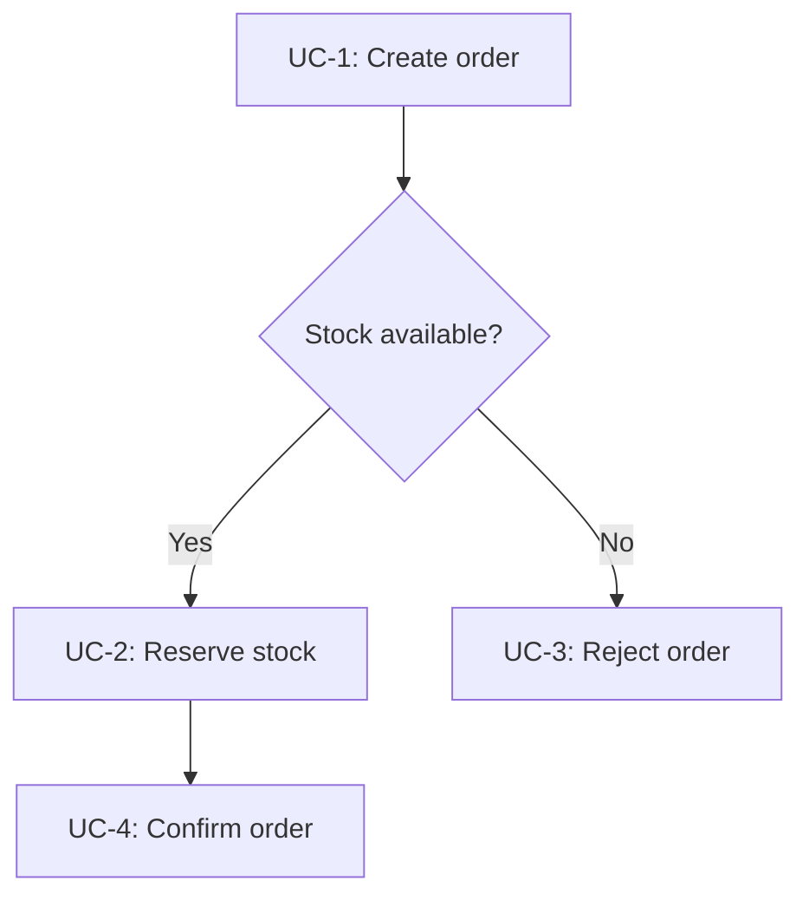
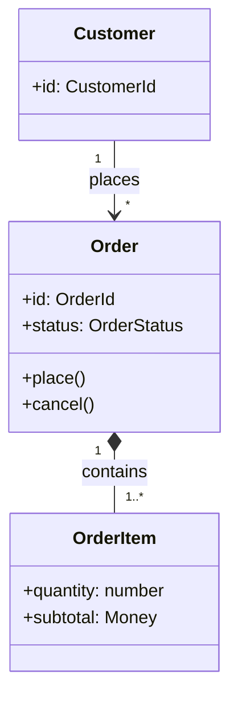

# 功能 Spec 模板

## 使用方法

创建新的 Feature Spec 时，遵循本模板的结构，输出到 `/docs/spec/{feature-name}.md`，并逐节填写。与当前功能无关的章节可以删除。

对于非代码类功能（流程设计、架构设计、规则定义等），可酌情裁剪章节。

---

# {功能标题}

**创建日期**：{YYYY-MM-DD}
**状态**：Draft / Review / Final
**输入来源**：{User Request / Design Discussion / Technical Proposal / Task Requirement}

---

## 背景与需求

<!-- 描述要解决的目标问题，以及不解决它会带来什么后果 -->

{背景描述}

---

## 用例与用户故事

<!--
  用户故事按优先级排序（P1/P2/P3）。
  每个用户故事必须可独立测试、可独立交付。
  P1 = 核心价值；即使只实现它，也应构成一个可用的 MVP。
  对于非交互类功能（如架构、流程、规则），可省略用户故事；
  改用“用例场景”描述系统行为。
  用户故事描述价值；用例场景描述连续/分支行为。
  两者互为补充，可同时使用。
-->

### 用户故事 1 — {标题}（优先级：P1）

{用户旅程的简要描述}

**优先级理由**：{为什么是 P1}

**独立验证**：{如何独立测试该故事——例如“运行 xxx 命令后应出现 xxx 输出”}

**验收场景**：

1. **Given** {初始状态}，**When** {动作}，**Then** {预期结果}
2. **Given** {初始状态}，**When** {动作}，**Then** {预期结果}

---

### 用户故事 2 — {标题}（优先级：P2）

{用户旅程的简要描述}

**优先级理由**：{为什么是 P2}

**独立验证**：{如何独立测试该故事}

**验收场景**：

1. **Given** {初始状态}，**When** {动作}，**Then** {预期结果}

---

### 用户故事 3 — {标题}（优先级：P3）

{用户旅程的简要描述}

**优先级理由**：{为什么是 P3}

**独立验证**：{如何独立测试该故事}

**验收场景**：

1. **Given** {初始状态}，**When** {动作}，**Then** {预期结果}

---

### 用例场景

<!--
  以场景形式描述连续、分支或有状态的行为。
  使用 Mermaid 流程图串联各场景，展示它们之间的关联逻辑。
  保持场景标识（UC-1、UC-2……）稳定，便于测试用例回溯。
  图中使用具体示例名称；编写真实 Spec 时请替换。
-->

| 场景 | 触发 / 前置条件 | 主流程 | 分支 | 后置条件 |
|----------|------------------------|-----------|----------|---------------|
| UC-1 | {什么触发该场景} | 1. {Step} 2. {Step} | {条件} → UC-2；{条件} → UC-3 | {结果状态} |
| UC-2 | {…} | {…} | {…} | {…} |

---

## 设计

### 模块与职责

<!--
  定义清晰的归属边界。每段逻辑必须且只能属于一个模块。
  模块对外暴露接口；调用方只依赖接口，不依赖内部实现。
-->

| 模块 | 职责 | 依赖 | 暴露 |
|--------|---------------|------------|---------|
| {模块 A} | {该模块负责什么——它独有的职责} | {模块 B、外部服务 C} | {接口 X、接口 Y} |
| {模块 B} | {该模块负责什么} | — | {接口 Z} |

> 若依赖关系较为复杂，使用 Mermaid 图展示模块关系。

---

### 领域模型

<!--
  用 Mermaid classDiagram 描述核心实体/概念及其关系。
  展示关键属性、关键行为（方法）以及关系基数。
  图中使用具体示例名称；编写真实 Spec 时请替换。
  仅当存在图无法清晰表达的不变量或约束时，才补充可选的表格。
-->

| 实体 | 职责 | 关键不变量 |
|--------|---------------|----------------|
| {实体名称} | {它表示什么 / 负责什么} | {必须始终成立的规则} |

---

### 数据流

<!--
  描述数据如何进入系统、流经各模块并最终输出。
  回答：什么触发该数据流？消费了哪些输入数据？产生了什么输出？
-->

**触发**：{什么事件或条件启动该数据流}

**Input** → **处理** → **Output**：

| 阶段 | 模块 | 输入数据 | 动作 | 输出数据 |
|-------|--------|------------|--------|-------------|
| 1 | {模块 A} | {原始输入——类型、格式} | {它做了什么} | {转换后的数据——类型、格式} |
| 2 | {模块 B} | {来自阶段 1 的数据} | {它做了什么} | {最终输出——类型、格式} |

---

### 接口设计

<!--
  每个接口必须明确：输入什么、输出什么、可能出什么错。
  每个接口使用单独的子章节。
-->

#### {接口名称}

| 方面 | 详情 |
|--------|--------|
| **职责** | {用一句话说明该接口做什么} |
| **归属** | {拥有该接口的模块} |
| **调用方** | {调用该接口的模块或外部系统} |

**Input**：

| 参数 | 类型 | 必填 | 约束 | 默认值 |
|-----------|------|:--------:|-------------|---------|
| {name} | {类型 / 枚举} | 是/否 | {范围、格式、长度限制、允许值} | {值} |

**Output**：

| 字段 | 类型 | 说明 |
|-------|------|-------------|
| {name} | {类型} | {该字段的含义} |

**错误场景**：

| 条件 | 错误 | 消息 | 恢复方式 |
|-----------|-------|---------|----------|
| {何时发生} | {错误类型/码} | {面向用户的消息} | {调用方应如何处理} |

---

### 内部逻辑

<!--
  描述每个模块如何将输入处理为输出。
  使用分步描述或伪代码——不要写实现代码。
-->

#### {逻辑单元名称}

**触发**：{什么启动该逻辑}

**Steps**：

1. {Step 1——描述动作，而非代码}
2. IF {条件} THEN {分支动作} ELSE {备选动作}
3. {Step 3}

**决策表**（如适用）：

| 条件 | 输入状态 | 动作 | 输出状态 |
|-----------|-------------|--------|--------------|
| {何时} | {状态 A} | {会发生什么} | {状态 B} |

---

### 交互设计

<!-- 用户与系统的交互流程、关键界面布局或操作序列 -->

> 可选：使用 Mermaid 时序图描述交互

---

### 可配置项

| 配置项 | 默认值 | 说明 |
|-------------|:-------------:|-------------|
| {key} | {value} | {说明} |

---

## 分解索引

<!--
  当 Spec 范围过大、无法在单个文档中描述全部细节时，使用本章节。
  “Design” 仅保留分层架构（模块、领域模型、数据流、关键接口）；
  各功能点的详细设计拆分为独立的 Spec。
  不适用时删除本注释与表格。
-->

| 功能点 | 详细 Spec | 说明 |
|---------------|---------------|-------------|
| {功能点名称} | [`spec-{name}.md`](./{parent-feature}/spec-{name}.md) | {简要说明} |

---

## 边界情况与错误处理

| 场景 | 预期行为 |
|----------|-------------------|
| {空输入} | {如何处理} |
| {极值输入} | {如何处理} |
| {并发访问} | {如何处理} |
| {依赖不可用} | {降级策略} |
| {非法操作} | {错误消息} |

---

## 测试用例

<!--
  使用 Given/When/Then 定义可验证的测试用例。
  每个测试用例必须至少映射到一个用户故事（或用例场景）。

  每个测试用例必须声明其类型：
  - Unit         —— 单个函数/模块，依赖被隔离
  - Integration  —— 跨模块协作，使用真实的存储/IO
  - E2E          —— 从入口到可观测输出的完整路径
  - Manual       —— 必须由人工执行；需写明具体步骤与预期结果

  “Test File / Method” 列在交付阶段填写：
  每个已实现的测试用例记录覆盖它的测试文件与测试方法。
  对于人工测试用例，记录人工验证结果的归档位置。
-->

| # | 用户故事 | 类型 | Given | When | Then | 测试文件 / 方法 |
|---|:----------:|------|-------|------|------|--------------------|
| 1 | US-1 | Unit | {初始状态} | {动作} | {预期结果} | `tests/{module}/{name}.test.ts` · `{test method name}` |
| 2 | US-1 | Integration | {初始状态} | {动作} | {预期结果} | `tests/{module}/{name}.test.ts` · `{test method name}` |
| 3 | US-2 | E2E | {初始状态} | {动作} | {预期结果} | `tests/{e2e}/{name}.test.ts` · `{test method name}` |
| 4 | US-2 | Manual | {初始状态} | {动作} | {预期结果} | {人工验证结果的记录位置} |

---

## 约束与限制

### 技术约束

{依赖版本、性能要求、兼容性要求}

### 业务约束

{不可违背的业务规则、合规/安全要求}

### 已知风险

{最大的不确定性、最可能出现问题的环节}

### 影响范围

{受影响的其他模块、是否需要修改既有代码}

---

## 实施计划

> 本节在开发过程中持续更新。按里程碑粒度拆分，将每个里程碑与功能点和风险关联。

### [x] 里程碑 1 — {标题}

- [x] {功能点 1}
  - 已知问题/风险：{交付时仍遗留、待后续解决的问题/风险}

### [ ] 里程碑 2 — {标题}

- [x] {功能点 2}
  - 已知问题/风险：{同上}
